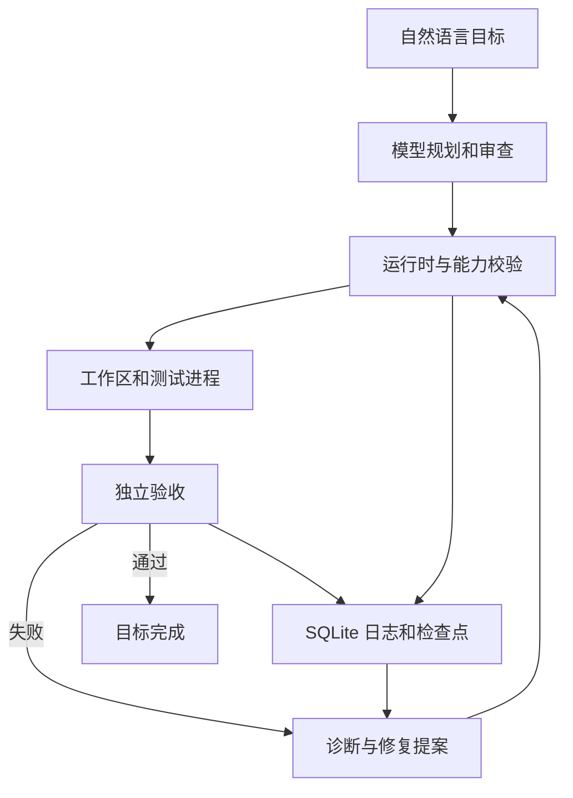

# Harness 架构与运行边界

## 决策和执行

- `providers.py` 提供统一的 `Provider.decide()`。Ollama 和 llama.cpp 运行 JSON 决策，调用本地回环服务。Codex 适配器使用临时目录、只读 sandbox、关闭 shell/Apps/插件，并通过 JSONL 和最终答复读取结构化提案。Mock 仅包含可复现的演示决策。
- `runtime.py` 从自然语言提取最终目标、约束、验收检查和任务依赖，校验拓扑并按优先级调度。模型的计划和行动都是提案。程序根据工作区、策略和观察结果推进状态。没有工程检查的 L0/L1 可直接给出答案。工程任务使用 L2/L3，规则保留六个内部审查标签。
- `policy.py` 限制授权路径、命令和预算。模型只能读取可见源文件，为编辑路径提出精确替换或新文件，以及请求已批准检查。拒绝绝对路径、路径穿越、链接、硬链接和常见凭据路径。工具输出不能增加能力。
- `evaluation.py` 根据进程结果、文件存在、文件内容、SHA-256、变化和未变化条件验收。状态包括 PASS、FAIL、NOT_RUN、BLOCKED 和 ERROR。配置的人工检查保留 NOT_RUN。若它是必需项，整个目标保留 BLOCKED。旧版 `goal_check.py` 仍是人工记录工具。
- `store.py` 用 SQLite 保存目标、计划、任务状态、最新安全位置、证据事件、写入回执、诊断和关系边。失败修复后验收当前检查，并保护之前通过的回归检查与已完成任务。修复引入回归时，撤销该次写入，重新测试恢复后的源码，再把回归证据提供给下一次诊断。相同源状态下已测试过的同一补丁不会再次写入。默认每个任务总共至多三轮候选修复，即使根因签名发生变化也不会继续扩大次数。
- 经验按测试 ID、功能、错误签名查询。新修复可引用可核实的历史记录。验证通过表示该变更在记录的条件下通过测试，根因解释仍是推断。复用后出现回归的记录可通过关系和验证事件追查。加入新回归检查需要操作者更新 policy 与测试。

## 策略示例

示例 policy 在 [examples/harness/policy.json](../../examples/harness/policy.json)。策略是操作者批准的运行清单，放在工作区外。工作区必须已存在。

| 键 | 含义 |
| --- | --- |
| `files` | 可读取或供隔离测试使用的显式文件清单。每个文件最多 128 KiB，清单最多 128 个路径 |
| `editable` / `visible` | 可改文件与可展示给模型的文件。两组都必须属于 `files` |
| `checks` | 验收检查。每项可声明 `description`、`feature`、`required`、`regression` |
| `command` | 已批准的 `argv` 数组、预期 `exit` 和可选 `stdout_contains`。默认 `execution: isolated` |
| `exists` / `contains` / `sha256` | 指定 `path`，后两种另需预期 `value` |
| `changed` / `unchanged` | 指定 `path`，对照目标创建时的文件哈希 |
| `manual` | 需要人或外部设备判断的检查，保留 NOT_RUN |
| `probe_before_work` | 自动执行已配置验收，跳过已满足的任务，对失败检查进入诊断。适用于只需可执行证据的修复目标 |
| `evaluate_after_edit` | 文件修改后立即使用验收来决定完成或进入修复。适用于验收已覆盖全部目标的编辑 |
| `limits` | `seconds`、`model_calls`、`commands`、`command_seconds`、`repair_rounds` |

建议把验收测试放在非可编辑文件清单中。测试和回归是否覆盖用户需要的功能仍由策略作者负责。只检查文件存在不能验证界面体验、安装和真机行为。

## 中断与调度

任务状态通过代码转换，依赖条件满足后才执行。运行前核对授权文件摘要。进程异常退出时，能用原始和目标摘要判断原子写入发生在哪一步。确认已有写入就进入验收，遇到第三方修改保留现场并阻塞。独立测试使用可重建的只读快照，可安全重跑。显式批准的可信命令在无法确认副作用时阻断重放。需要新范围时用 `revise` 建新目标并记录替代关系。

支持即时运行、排队、单次时间片、暂停、取消和恢复。重复调度由操作者显式配置。共享工作区的运行请使用同一个状态目录，以共享锁。外部编辑器或 git 操作只在单次执行前后的摘要核对中可见，运行期间避免并发改动。同一数据库可查询已完成任务、失败、根因假设、修复及关联经验。

## 权限和限额

- Linux 默认执行隔离检查。仅将授权清单中的 UTF-8 文件快照、只读系统运行库、隔离进程视图和有限临时目录放进 bubblewrap。seccomp 禁用套接字、派生进程等能力。命令使用隔离系统 Python，不能启动多进程构建，不能直接把编译产物写回项目。
- 原生 Windows 的命令检查默认阻塞。只对经过审查的测试可在 policy 声明 `trusted` 并显式添加 `--allow-trusted-tests`。这类命令在当前账号下运行，工作目录限制与环境变量过滤不能充当 OS 沙箱。避免让不可信源码经由此路径运行。
- 环境凭据值和常见凭据模式会被过滤。运行状态仍含授权源文件片段、日志、差异和本地路径，分享前应检查。Windows 依赖安装目录所在用户的 ACL。无法识别所有不规则或经过编码的秘密，授权模型读取前先排除这些资料。
- 限制总时间、子进程时间、模型调用、命令次数、输入/输出大小和修复轮次。默认没有网络测试、自动安装、云服务、后台守护程序。模型 API 的另行配额与计费由操作者负责。
